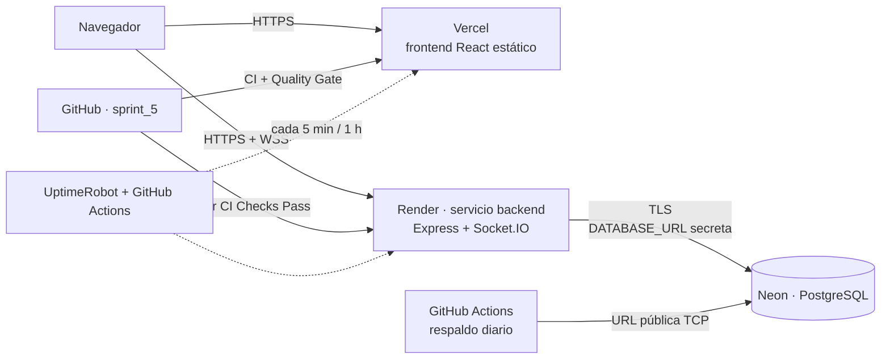

# Manual de despliegue y operación — CanchaYa (Vercel + Render + Neon)

Cubre US-22 a US-26: configuración de plataformas, despliegue, respaldos, monitoreo, rollback y entrega. La rama que se despliega a producción es **`sprint_5`** (última entrega).

> **Decisión de plataforma para el backend.** Las historias US-22/US-23 nombran Railway, pero Railway ya no ofrece una prueba gratuita para encender el backend y el equipo no cuenta con presupuesto para el plan Hobby. Por eso el backend se despliega en **Render (plan gratuito, sin tarjeta)** y la base de datos en **Neon (plan gratuito)**; el frontend sigue en **Vercel**. Lo que cambia respecto al texto de las historias: (1) el backend y la base no están «en el mismo proyecto» ni se comunican por variables de referencia de la plataforma: la cadena de conexión de Neon se guarda como secreto en Render y nunca en el repositorio; (2) el plan gratuito de Render **suspende el servicio tras 15 minutos sin tráfico** (ver [4A.4](#4a4-suspensión-por-inactividad-y-cómo-mitigarla)). La configuración de Railway se conserva (sección 4B) como alternativa de pago por si el equipo la contrata; conviene informar este cambio al docente.

> **Qué está en el repositorio y qué se hace en los paneles.** Todo lo que se puede dejar como código ya está en el repositorio: `backend/railway.json`, `frontend/vercel.json`, los workflows de `.github/workflows/`, los scripts de `scripts/respaldo/` y las pruebas de humo y carga. Lo que depende de cuentas, secretos y dominios (crear proyectos, activar la verificación en dos pasos, pegar variables) solo se puede hacer en Railway, Vercel y GitHub; esta guía lo explica paso a paso y el [checklist de entrega](#13-checklist-de-entrega-us-22-a-us-26) indica qué evidencia guardar.

## 1. Arquitectura



| Pieza | Dónde corre | Qué sirve |
| --- | --- | --- |
| Frontend | Vercel (proyecto `canchaya-frontend`, carpeta `frontend/`) | La aplicación React compilada (`npm run build`). Recarga en cualquier ruta gracias a la reescritura de `frontend/vercel.json`. |
| Backend | Render, servicio `canchaya-backend` (carpeta `backend/`, su `Dockerfile` de US-19; definido en `render.yaml`) | API REST `/api` y socket de reservas (Socket.IO). Lee `PORT` de Render. |
| Base de datos | Neon, proyecto `canchaya-prod` | PostgreSQL gestionado con almacenamiento persistente; el backend se conecta con `DATABASE_URL` por TLS. (Alternativa: servicio `Postgres` de Railway, sección 4B.) |
| Pipeline | GitHub Actions (`ci-cd.yml`) | Pruebas, SonarQube, Docker y despliegue del frontend a producción. |

## 2. Entornos y ramas

| Entorno | Rama / disparador | Frontend (Vercel) | Backend + BD (Railway) |
| --- | --- | --- | --- |
| **Producción** | `sprint_5` | Despliegue de producción, lo publica el pipeline si todo está en verde | Servicio `canchaya-backend` + proyecto Neon `canchaya-prod` |
| **Staging** (opcional) | Rama `staging` (se crea a partir de `sprint_5`) | Preview de esa rama | Segundo servicio `canchaya-backend-staging` en Render (las 750 h gratuitas se reparten entre servicios: encenderlo solo para probar) + **otro** proyecto Neon `canchaya-staging` |
| **Preview** | Cada Pull Request | Preview con URL propia (`canchaya-git-<rama>-<equipo>.vercel.app`) apuntando al backend de staging | — |

Staging y producción tienen **variables y secretos distintos** (JWT, base de datos, dominios). Una cuenta o un token de staging nunca sirve en producción.

## 3. Cuentas, accesos y verificación en dos pasos (US-22)

1. Cada integrante crea o usa su cuenta de **GitHub** (ya existe) y entra a Railway y Vercel con «Continue with GitHub».
2. **Verificación en dos pasos (2FA) obligatoria**, para las tres plataformas:
   - GitHub: *Settings → Password and authentication → Two-factor authentication* (app autenticadora, no SMS).
   - Vercel: *Account Settings → Security → Two-Factor Authentication* (en Vercel se activa en la cuenta personal; si se inicia con GitHub, la protege el 2FA de GitHub, y conviene activar también un método propio).
   - Railway: *Account Settings → Security* (2FA). Si el inicio es solo con GitHub, queda protegido por el 2FA de GitHub; activar el propio si el panel lo ofrece.
   - Guardar los códigos de recuperación en un gestor de claves del equipo, no en el repositorio.
3. Roles (mínimo privilegio):

   | Integrante | GitHub | Railway | Vercel |
   | --- | --- | --- | --- |
   | Dueño de la cuenta (uno) | Admin | Admin del proyecto | Owner |
   | Resto del equipo | Write | Member (puede ver logs y variables de staging; las de producción solo quien despliega) | Member (no Owner) |
   | Docente (solo lectura, si lo pide) | Read | Viewer | Viewer |

   Las invitaciones se envían desde *Project → Settings → Members* (Railway) y *Team → Settings → Members* (Vercel).
4. Dejar constancia (captura de cada pantalla de miembros y de «2FA enabled») en `docs/evidencias-despliegue/`.

## 4A. Render + Neon: backend y base de datos sin costo (US-22 y US-23)

### 4A.1 Base de datos en Neon
1. En neon.com, con GitHub y 2FA activo, *New Project* → nombre `canchaya-prod`, la versión de PostgreSQL por defecto y la región más cercana (Estados Unidos Este suele dar menor latencia hacia Colombia).
2. **Debe ser un proyecto nuevo, distinto del que usa el equipo para desarrollo**, para no mezclar datos de prueba con los de producción.
3. *Connect* → copiar la cadena de conexión **directa** (sin `-pooler`) con `sslmode=require`. Es un secreto: se pega en Render, nunca en el repositorio, un chat o un commit.
4. Plan gratuito de Neon: 100 horas de cómputo por mes y por proyecto, 1 GB de almacenamiento y 5 GB de transferencia; el cómputo se suspende solo a los 5 minutos sin actividad y despierta en unos segundos (el backend reintenta la conexión al arrancar).

### 4A.2 Servicio en Render
1. En render.com, con GitHub y 2FA activo: *New → Blueprint* y elegir este repositorio. Render lee [render.yaml](../render.yaml) (Docker, plan `free`, rama `sprint_5`, healthcheck `/api/health`, despliegue «tras pasar el CI»).
2. Render pide los valores marcados como secretos (no están en el repositorio):

   | Variable | Valor |
   | --- | --- |
   | `DATABASE_URL` | La cadena de Neon del paso 4A.1. |
   | `CORS_ORIGIN` | `https://<dominio-frontend-en-vercel>`. Si aún no existe, un valor temporal y se corrige luego (*Environment*). Solo el frontend de producción. |
   | `SMTP_HOST`, `SMTP_USER`, `SMTP_PASS`, `SMTP_FROM` | Datos del proveedor de correo (necesarios para recuperar contraseña y cambiar el correo). Pueden quedar vacíos y completarse después. |

   `JWT_SECRET` lo genera Render (`generateValue`), `PORT` la inyecta Render y el backend la lee. El resto de variables (`NODE_ENV`, `TRUST_PROXY`, `EXIGIR_HTTPS_PAGOS`, `API_DOCS_HABILITADA=false`, `SEED_INICIAL=true`, `LOG_CORREO_DETALLE=false`) ya vienen del blueprint.
3. *Settings → Build & Deploy → Auto-Deploy*: debe quedar **«After CI Checks Pass»**: Render solo despliega cuando el workflow *CI/CD* del commit termina en verde.
4. Dirección pública: `https://canchaya-backend.onrender.com` (o la que asigne Render), con certificado TLS automático. Dominio propio: *Settings → Custom Domains* y el registro DNS que indique.
5. **WebSocket:** Render soporta WebSocket (y por tanto el socket de reservas por **WSS**) en el mismo puerto y dominio del backend; no requiere configuración extra.

### 4A.3 Qué hace cada despliegue y administrador inicial
El `Dockerfile` arranca con `node src/db/migrate.js` (esquema idempotente, sin borrar datos); con `SEED_INICIAL=true` carga después el catálogo de canchas **solo si la tabla está vacía**; y entonces inicia el servidor. Si la migración falla, el contenedor no arranca y Render conserva la versión anterior. Render comprueba `GET /api/health` antes de pasarle el tráfico.

El administrador se crea una sola vez, sin credenciales por defecto, desde tu computador con la cadena de Neon de producción:

```powershell
cd backend
$env:DATABASE_URL = "<cadena de conexión de Neon>"   # no se guarda en ningún archivo
$env:JWT_SECRET   = "cualquier-valor"                 # solo para que el script arranque; no se usa
$env:ADMIN_PASSWORD = Read-Host "Contraseña del administrador (mín. 8, letra y número)"
npm run crear:admin -- correo.del.admin@dominio.com "Nombre Apellido"
Remove-Item Env:ADMIN_PASSWORD, Env:DATABASE_URL, Env:JWT_SECRET
```

### 4A.4 Suspensión por inactividad y cómo mitigarla
Un servicio gratuito de Render se **suspende tras 15 minutos sin tráfico entrante** (las conexiones WebSocket inactivas no lo impiden) y tarda alrededor de un minuto en despertar con la primera petición. Mientras está suspendido no hay sockets ni temporizadores en memoria: al despertar, el backend restaura de la base las sesiones de reserva vigentes (`restaurarSesiones`), pero los usuarios conectados perderían la conexión y se reconectan solos.

| Opción | Qué hace | Costo |
| --- | --- | --- |
| **Monitor de UptimeRobot cada 5 minutos** (sección 10.1) a `/api/health` | Mantiene el servicio despierto: las 750 horas gratuitas del mes alcanzan para un solo servicio encendido todo el mes (744 h). Con dos servicios, no. La política de Render sobre este tipo de monitores no es explícita: es válido para la demostración académica, no para un producto real. | 0 |
| **Despertarlo antes de la demostración** | Abrir `/api/health` uno o dos minutos antes y comprobar que responde. | 0 |
| **Plan pagado de Render (≈ USD 7 al mes)** | Sin suspensión. | USD 7 |

Neon también se suspende solo. `/api/health` no consulta la base, y el barrido de retenciones de reserva solo consulta la base cada ≈ 5 minutos cuando no hay nadie conectado, así que un monitor externo no consume horas de cómputo de Neon; las usan los usuarios reales.

### 4A.5 Respaldo
El workflow `respaldo-bd.yml` y los scripts de `scripts/respaldo/` funcionan igual: el secreto `BACKUP_DATABASE_URL` es la cadena de conexión de Neon, y la variable `PG_VERSION` debe coincidir con la versión de PostgreSQL del proyecto de Neon (por defecto 17).

## 4B. Alternativa de pago: Railway (USD 5 al mes) — US-22 y US-23 tal como están redactadas

### 4.1 Crear el proyecto

1. *New Project → Deploy from GitHub repo* → `JuanAZ-uao/…` (este repositorio). Nombre: `canchaya`.
2. En el servicio creado (renómbralo **`backend`**): *Settings →*
   - **Root Directory:** `/backend`
   - **Config as code → Config file path:** `/backend/railway.json` (el archivo trae el *builder* Dockerfile, el healthcheck `/api/health`, el reinicio ante fallos y los comandos de pre-despliegue).
   - **Branch:** `sprint_5` (producción).
   - **Wait for CI:** activado. Railway no despliega hasta que el workflow *CI/CD* del commit termine en verde (así el backend sigue la misma regla que el frontend).
3. *New → Database → Add PostgreSQL* (servicio **`Postgres`**, dentro del mismo proyecto). Trae un volumen persistente.

### 4.2 Variables del backend (por referencia, no copiadas)

*backend → Variables.* La conexión **no se copia a mano**: se usa una variable de referencia al servicio `Postgres`.

| Variable | Producción | Staging | Nota |
| --- | --- | --- | --- |
| `DATABASE_URL` | `${{Postgres.DATABASE_URL}}` | `${{Postgres.DATABASE_URL}}` | Referencia (red privada `*.railway.internal`); cada entorno apunta a su propio Postgres. |
| `JWT_SECRET` | `${{ secret(64) }}` | `${{ secret(64) }}` | Railway lo genera y no se escribe en ningún archivo; distinto en cada entorno. |
| `NODE_ENV` | `production` | `production` | |
| `CORS_ORIGIN` | `https://<dominio-frontend-produccion>` | `https://<dominio-staging>,https://canchaya-*.vercel.app` | Solo el frontend de Vercel. Acepta varios separados por comas; el `*` solo vale para las previews del propio proyecto (`canchaya-*`), nunca para `*.vercel.app` completo. |
| `TRUST_PROXY` | `true` | `true` | El tráfico llega por el proxy de Railway con TLS. |
| `EXIGIR_HTTPS_PAGOS` | `true` | `true` | Las rutas de tarjetas solo por HTTPS. |
| `API_DOCS_HABILITADA` | `false` | `true` | Swagger solo en staging. |
| `PASARELA_PAGO` | `simulada` | `simulada` | Sin credenciales; cambiar solo si se contrata una pasarela real. |
| `SMTP_HOST`, `SMTP_PORT`, `SMTP_USER`, `SMTP_PASS`, `SMTP_FROM` | datos del proveedor de correo | idem (cuenta de pruebas) | **Necesarios** para recuperación de contraseña y cambio de correo. Sin SMTP el correo no se envía (y en producción el log no muestra el enlace). |
| `MAX_RESERVAS_ACTIVAS_USUARIO`, `HORAS_MIN_CANCELACION` | opcionales | opcionales | Valores por defecto: 5 y 2. |

`PORT` **no se define**: Railway la inyecta y el backend la lee (`backend/src/config/env.js`).

> Nunca pegues credenciales en el repositorio, en un `Dockerfile` ni en un comentario. `.env` está en `.gitignore`; solo `.env.example` (sin valores reales) se versiona. Si una clave se filtra, se rota en el panel y se vuelve a desplegar.

### 4.3 Qué hace cada despliegue (migraciones y datos iniciales)

`backend/railway.json` ejecuta, **antes** de arrancar la nueva versión (*pre-deploy*):

1. `node src/db/migrate.js`: aplica `schema.sql`, que es idempotente (`IF NOT EXISTS`, `ADD COLUMN IF NOT EXISTS`); no borra datos.
2. `node src/seed/seedInicial.js`: carga el catálogo de canchas con sus horarios **solo si la tabla `canchas` está vacía**; nunca borra ni duplica.

Si cualquiera de los dos falla, el despliegue se aborta y **la versión anterior sigue en servicio**. Después Railway comprueba `GET /api/health` (hasta 60 s); si no responde, tampoco hace el cambio.

**Administrador inicial (sin credenciales por defecto).** No existe ninguna cuenta de administrador predefinida. Se crea una vez, desde tu computador, con la URL **pública** de la base (variable `DATABASE_PUBLIC_URL` del servicio `Postgres`):

```powershell
cd backend
$env:DATABASE_URL = "<DATABASE_PUBLIC_URL>"   # no se guarda en ningún archivo
$env:JWT_SECRET   = "cualquier-valor"           # solo para que el script arranque; no se usa
$env:ADMIN_PASSWORD = Read-Host "Contraseña del administrador (mín. 8, letra y número)"
npm run crear:admin -- correo.del.admin@dominio.com "Nombre Apellido"
Remove-Item Env:ADMIN_PASSWORD, Env:DATABASE_URL, Env:JWT_SECRET
```

Si el correo ya está registrado, solo se promueve a administrador y no hace falta contraseña.

### 4.4 Dominio, HTTPS y WebSocket

- *backend → Settings → Networking → Generate Domain* da `https://<servicio>.up.railway.app` con certificado TLS automático. Para un dominio propio: *Custom Domain*, y crear en el proveedor DNS el registro `CNAME` que Railway indique.
- **WebSocket.** Railway soporta conexiones WebSocket persistentes en sus planes de pago (HTTP, TCP, gRPC y WebSockets están soportados por la plataforma; el cliente debe reconectarse por su cuenta, y Socket.IO ya lo hace). El socket de reservas (US-17/18) comparte el dominio y el puerto del backend, así que funciona por **WSS** sin configuración extra. Se comprueba en cada ejecución de las pruebas de humo (verificación «Socket (WSS)»).
- Railway reinicia el servicio en cada despliegue y envía `SIGTERM`; el backend lo atiende cerrando las conexiones con orden y el cliente de Socket.IO se reconecta.

## 5. Vercel: proyecto y frontend (US-22 y US-24)

1. *Add New → Project →* importar el repositorio. **Root Directory:** `frontend`. El resto lo toma de `frontend/vercel.json` (*framework* Vite, `npm run build`, salida `dist`, reescritura de rutas).
2. *Settings → Git → Production Branch:* `sprint_5`.
3. *Settings → Environment Variables* (cada una con el alcance indicado):

   | Variable | Production | Preview | Valor |
   | --- | --- | --- | --- |
   | `VITE_API_URL` | ✔ | ✔ | Producción: `https://<backend-prod>.up.railway.app/api`. Preview: `https://<backend-staging>.up.railway.app/api`. Siempre **HTTPS**. |
   | `VITE_SOCKET_URL` | opcional | opcional | Solo si el socket tuviera otra dirección; por defecto es la de la API sin `/api`. |

   Si falta `VITE_API_URL` o no empieza por `https://`, **el build de Vercel falla** (lo valida `frontend/vite.config.js`), en vez de publicar una app que llame a `localhost` o cause contenido mixto. En el código no hay direcciones de desarrollo (`frontend/src/config.js` solo las usa en `npm run dev` y pruebas).
4. **Previews.** La integración Git de Vercel genera un despliegue de preview con URL propia por cada Pull Request y por cada rama distinta de `sprint_5`.
5. **Producción y el pipeline.** Por defecto la integración Git de Vercel publica `sprint_5` al fusionar (modo directo). Para cumplir con rigor "el despliegue a producción solo ocurre si los chequeos están aprobados" existe el **modo pipeline**: (a) añadir a `frontend/vercel.json` el bloque `"git": { "deploymentEnabled": { "sprint_5": false } }`, que apaga el despliegue automático de esa rama; (b) crear la variable de GitHub `DESPLIEGUE_VERCEL_POR_PIPELINE=true`; (c) crear los secretos `VERCEL_TOKEN`, `VERCEL_ORG_ID` y `VERCEL_PROJECT_ID` (token en *Account Settings → Tokens*; los IDs en *Project → Settings* y *Team → Settings*). Entonces el job `desplegar-frontend` publica con la CLI únicamente cuando backend, frontend, SonarQube (Quality Gate) y Docker pasaron. **Importante:** apagar el despliegue automático sin tener el modo pipeline listo deja a la rama sin publicar (el frontend se queda con la versión anterior y las rutas internas dan 404).
6. **Dominio.** *Project → Settings → Domains → Add.* Sin dominio propio sirve `https://<proyecto>.vercel.app`; con dominio propio se crea el registro DNS que Vercel muestre. El certificado HTTPS es automático. Actualizar `CORS_ORIGIN` en Railway con el dominio final.
7. **Historial de despliegues.** *Project → Deployments* muestra cada despliegue con su commit, fecha y autor; la versión que corre el backend se ve en `GET /api/health` (campo `version`, el commit de 7 caracteres).

## 6. Variables y secretos de GitHub Actions

| Tipo | Nombre | Para qué |
| --- | --- | --- |
| Variable | `DESPLIEGUE_NUBE` | `true` activa los jobs de nube (`desplegar-frontend`, `verificar-produccion`, monitoreo y respaldo). Mientras no exista, el pipeline sigue como antes. |
| Variable | `PROD_WEB_URL`, `PROD_API_URL` | `https://<frontend>` y `https://<backend>/api`. |
| Variable (opcional) | `DESPLIEGUE_VERCEL_POR_PIPELINE` | `true` activa el modo pipeline de la sección 5.5. |
| Secreto (solo modo pipeline) | `VERCEL_TOKEN`, `VERCEL_ORG_ID`, `VERCEL_PROJECT_ID` | Publicar el frontend con la CLI. |
| Secreto | `BACKUP_DATABASE_URL`, `BACKUP_PASSPHRASE` | Respaldo diario (sección 8): cadena de conexión de Neon (o la URL pública de Railway) y clave de cifrado. |
| Secreto (opcional) | `ALERTAS_WEBHOOK_URL` | Webhook entrante de Slack o Discord para las alertas. |
| Existentes | `SONAR_TOKEN`, `JWT_SECRET`, `POSTGRES_PASSWORD`; variable `SONAR_HOST_URL` | Pipeline actual (Sprint 4). |

Ningún secreto está en el repositorio, en las imágenes Docker ni en los logs: GitHub enmascara los secretos en los logs de Actions, `backend/Dockerfile` no copia `.env` (`.dockerignore`) y el backend no registra tokens ni contraseñas (sección 9).

## 7. Cómo se despliega y cómo se vuelve atrás (US-23, US-24 y US-26)

### 7.1 Despliegue

1. Se fusiona un PR en `sprint_5`.
2. GitHub Actions ejecuta backend, frontend, SonarQube y Docker. Si algo falla, **no se despliega nada**.
3. En paralelo, Railway espera el CI (*Wait for CI*), construye con el `Dockerfile`, corre migración y datos iniciales (*pre-deploy*), comprueba `/api/health` y cambia el tráfico.
4. El job `desplegar-frontend` publica el frontend en Vercel.
5. El job `verificar-produccion` espera a que `/api/health` informe el commit nuevo y ejecuta las **pruebas de humo** (sección 12). Si fallan, el job queda en rojo y hay que revisar o hacer rollback.

### 7.2 Rollback del frontend (Vercel)

*Project → Deployments →* elegir un despliegue anterior en estado *Ready* → menú **⋯ → Instant Rollback** (o *Promote to Production*). Es inmediato (la URL de producción pasa a apuntar al despliegue anterior, sin reconstruir). En el plan Hobby el rollback instantáneo puede estar limitado al despliegue de producción inmediatamente anterior; si hace falta uno más antiguo, usar *Promote to Production* sobre el despliegue deseado. También sirve `npx vercel rollback` o hacer `git revert` y dejar que el pipeline publique.

### 7.3 Rollback del backend (Railway)

**Render:** *canchaya-backend → Events* → en un despliegue anterior exitoso, **Rollback** (vuelve a desplegar esa versión). **Railway:** *backend → Deployments →* despliegue anterior con estado *Active/Removed (successful)* → **⋯ → Redeploy** (vuelve a desplegar esa imagen), o `git revert` del commit y push a `sprint_5`. Mientras dura el cambio, la versión actual sigue atendiendo hasta que la nueva pase el healthcheck.

### 7.4 Rollback sin romper la base de datos

Regla del equipo: **cada versión solo hace cambios aditivos al esquema** (tablas, columnas o restricciones nuevas; nada de borrar ni renombrar en el mismo lanzamiento), de modo que la versión anterior del código sigue funcionando sobre la base ya migrada y el `schema.sql` anterior puede volver a aplicarse.

Ensayo realizado (PostgreSQL 16 local con datos reales de prueba, incluida una reserva en estado `cancelada_administrativamente`):

| Escenario | Resultado |
| --- | --- |
| Volver a aplicar el `schema.sql` **actual** (redeploy del mismo commit) | Correcto: no pierde datos ni falla. |
| Aplicar el `schema.sql` de la **entrega del Sprint 4** sobre la base ya migrada a Sprint 5 | **Falla** con `check constraint "chk_reservas_estado" … is violated by some row`: ese esquema antiguo no conoce el estado `cancelada_administrativamente`. El *pre-deploy* aborta y la versión actual sigue en servicio (no hay daño), pero **no se puede volver a la versión del Sprint 4** sin restaurar un respaldo anterior o ajustar la restricción a mano. |

Consecuencias:

- Los rollbacks **dentro de las versiones de Sprint 5** (el uso normal) son seguros.
- Antes de cualquier cambio de esquema **no aditivo**, tomar un respaldo manual (sección 8.3) y planificar la reversión (script SQL inverso).
- Si un rollback del backend falla en el *pre-deploy*, no se pierde servicio: Railway conserva la versión que corre. Diagnóstico: *Deployments → Logs* del intento fallido.

Los tiempos medidos del ensayo de rollback en producción se anotan en el checklist (sección 13).

## 8. Base de datos: persistencia y respaldos

### 8.1 Persistencia
El servicio `Postgres` de Railway usa un volumen persistente: los datos sobreviven a los despliegues y reinicios del backend. Las migraciones nunca borran datos (sección 4.3).

### 8.2 Respaldo diario automático (pg_dump) + restauración probada
Workflow `.github/workflows/respaldo-bd.yml`, todos los días a las 03:00 (hora de Colombia) o a mano (*Actions → Respaldo de la base de datos → Run workflow*):

1. Hace `pg_dump` (formato *custom*) de producción usando la URL pública (`BACKUP_DATABASE_URL`, secreto = `DATABASE_PUBLIC_URL` de Railway).
2. **Restaura ese respaldo en un PostgreSQL temporal y compara el número de filas de cada tabla con el original.** Si no coinciden, el workflow falla: la restauración queda probada todos los días.
3. Cifra el archivo con AES-256 (`BACKUP_PASSPHRASE`) y lo conserva 14 días como artefacto del workflow (contiene datos personales).

Complemento: *Postgres → Backups* de Railway (copias de volumen programadas diaria/semanal/mensual) si el plan contratado las incluye; son aditivas, no reemplazan al `pg_dump`, que no depende del plan.

### 8.3 Respaldo manual
```bash
DATABASE_URL="<DATABASE_PUBLIC_URL>" ./scripts/respaldo/respaldar.sh      # crea respaldo-canchaya-<fecha>.dump
```

### 8.4 Restaurar un respaldo
1. Descargar el artefacto `respaldo-bd` del workflow y descifrarlo:
   `openssl enc -d -aes-256-cbc -pbkdf2 -in respaldo-AAAAMMDD.dump.enc -out respaldo.dump` (pide `BACKUP_PASSPHRASE`).
2. **Ensayo (recomendado primero):** crear una base vacía (otro servicio `Postgres` en un entorno de pruebas o Docker local) y ejecutar
   `DATABASE_URL="<destino>" ./scripts/respaldo/restaurar.sh respaldo.dump` y luego
   `ORIGEN_URL="<producción>" DESTINO_URL="<destino>" ./scripts/respaldo/verificar-restauracion.sh`.
3. **Restauración real en producción** (pérdida o corrupción de datos): avisar al equipo, detener escrituras (poner el servicio `backend` en pausa: *Settings → Danger → Pause*/escalar a 0), restaurar con `restaurar.sh` sobre la URL pública de producción, ejecutar `verificar-restauracion.sh`, reanudar el backend y correr las pruebas de humo.

Ensayo documentado: en un PostgreSQL local con 32 usuarios, 5 canchas, 35 horarios y 32 reservas, `respaldar.sh` → `restaurar.sh` → `verificar-restauracion.sh` devolvió **«Verificación OK»** con todas las tablas idénticas. La misma verificación corre a diario en el workflow.

## 9. Logs (US-25)

| Qué | Dónde | Cómo filtrar |
| --- | --- | --- |
| Backend en Render | Render → servicio `canchaya-backend` → **Logs** | Por fecha, texto y nivel; el mismo contenido que en Railway (`[ERROR]`, `[METRICAS]`, `[SOCKET]`). |
| Backend en Railway (alternativa) | Railway → servicio `backend` → **Deployments → View Logs** y pestaña **Logs** | Por servicio y entorno (selector *production/staging*), por rango de fechas y con la caja de búsqueda (`@level:error`, `[ERROR]`, `[METRICAS]`, `[SOCKET]`). |
| Base de datos | Railway → servicio `Postgres` → **Logs** | Idem. |
| Frontend | Vercel → proyecto → **Logs** (peticiones al borde) y **Deployments → Build Logs** (compilación) | Por despliegue, fecha y estado HTTP. Los errores del navegador se ven en la consola del usuario (el frontend no envía logs al servidor). |
| Pipeline | GitHub → Actions | Por workflow y ejecución. |

**Qué no se registra.** El backend nunca imprime contraseñas, hashes ni tokens JWT. Los errores 500 se registran con método, ruta **sin parámetros de consulta**, código y pila (no el objeto completo del error de PostgreSQL, que puede traer valores de filas). Sin SMTP configurado en producción, los correos simulados solo dejan «correo … no enviado» (sin destinatario ni enlace con token); el detalle solo se imprime con `LOG_CORREO_DETALLE=true`, pensado para desarrollo y el entorno Docker local. Hay pruebas automáticas de esto (`backend/tests/emailService.test.js`).

## 10. Monitoreo y alertas (US-25)

### 10.1 Disponibilidad (uptime)
- **Externo, cada 5 minutos — UptimeRobot** (cuenta gratuita, 50 monitores, intervalo de 5 min): crear dos monitores HTTP(s):
  1. `https://<frontend>` — palabra clave `root`.
  2. `https://<backend>/api/health` — palabra clave `"estado":"ok"`.
  Contactos de alerta: correo de **todos** los integrantes (y el webhook de Slack/Discord, si existe).
- **Interno, cada hora — GitHub Actions** (`monitoreo.yml`): comprueba lo mismo con 3 reintentos; si falla, avisa al webhook, abre un issue `alerta-produccion` y marca la ejecución como fallida (GitHub envía correo). Es una segunda capa que no depende de un tercero.
- **Errores 5xx repetidos:** buscar `[ERROR]` en los logs de Railway; se recomienda guardar la búsqueda. Railway permite además notificaciones de despliegue fallido (*Project Settings → Notifications* y *Webhooks*) hacia correo o Slack/Discord.
- **Fallo de un despliegue:** Railway (notificación de *Deploy failed*), Vercel (*Settings → Notifications*), y GitHub Actions (correo de workflow fallido). El job `verificar-produccion` también falla si Railway no sirve el commit nuevo en 15 minutos.

### 10.2 Métricas y umbrales
Railway → servicio → **Metrics** (CPU, memoria, red) y servicio `Postgres` → **Metrics** (CPU, memoria, almacenamiento del volumen). Revisión semanal del equipo y umbrales de aviso:

| Métrica | Aviso | Crítico | Acción |
| --- | --- | --- | --- |
| Memoria del backend | > 70 % del límite del plan | > 90 % | Revisar fugas (línea `[METRICAS] memoria_mb`), subir el límite del servicio. |
| CPU del backend | > 70 % sostenido 10 min | > 90 % | Revisar tráfico; escalar. |
| Volumen de PostgreSQL | > 70 % lleno | > 85 % | Depurar datos antiguos o ampliar el volumen. |
| Conexiones de socket | > 70 % de lo medido en la prueba de carga | — | Ver 10.3. |
| Crédito de uso mensual de Railway | > 80 % consumido | > 100 % | Revisar consumo; Railway envía aviso al alcanzar el límite de gasto configurado (*Usage → Spending limit*, recomendado). |

### 10.3 Conexiones activas del socket
El backend escribe cada minuto una línea `[METRICAS] sockets_activos=<n> memoria_mb=<m>` (sin datos de usuarios). Se consulta en los logs de Railway buscando `[METRICAS]`; sirve para ver picos y compararlos con la prueba de carga (100 conexiones simultáneas verificadas en CI con `npm run test:carga`). Intervalo ajustable con `METRICAS_INTERVALO_MS`.

### 10.4 Simulación de alerta
*Actions → Monitoreo de disponibilidad → Run workflow → simular_caida = true.* Debe: (a) enviar el mensaje al webhook, (b) abrir/actualizar el issue `alerta-produccion` y (c) terminar en rojo con correo de GitHub. Se prueba además pausando un monitor de UptimeRobot o apuntándolo a una URL inexistente. Guardar capturas del correo recibido en `docs/evidencias-despliegue/`. (Lógica verificada localmente: el script de comprobación devuelve «OK» con servicios sanos y genera la alerta con un servicio caído o con la simulación.)

### 10.5 Quién recibe las alertas y qué hacer

| Alerta | Recibe | Qué hacer |
| --- | --- | --- |
| Sitio caído (frontend) | Todo el equipo (UptimeRobot + GitHub) | Abrir `https://vercel.com/<equipo>/<proyecto>` → ¿último despliegue en error? Si sí, *Instant Rollback*. Si Vercel está en incidente, esperar y avisar (estado: vercel-status.com). |
| API caída (`/api/health`) | Todo el equipo | Railway → `backend` → Logs. ¿Se reinició por memoria o falló el arranque? Revisar `DATABASE_URL` y variables. Si fue un despliegue, *Redeploy* del anterior. |
| Errores 5xx repetidos | Todo el equipo | Buscar `[ERROR]` en los logs: ruta, código y pila. Si es la BD (`ECONN`, `53300`), revisar el servicio `Postgres` y las conexiones; si es una regresión, rollback. Registrar el error en Jira (tipo Error, vinculado a su historia). |
| Despliegue fallido | Quien hizo el merge + equipo | Leer el log de la etapa que falló (pruebas, build, *pre-deploy* o healthcheck). La versión anterior sigue sirviendo; corregir y volver a fusionar. |
| Respaldo fallido | Quien creó los secretos | Revisar `BACKUP_DATABASE_URL` (la URL pública cambia si se recrea el proxy) y la versión de `pg_dump` (`PG_VERSION`). Hacer un respaldo manual el mismo día. |
| Almacenamiento/memoria sobre el umbral | Dueño de la cuenta Railway | Ver 10.2. |

Responsable de guardia durante la demostración y la semana de cierre: el integrante que hizo el último merge a `sprint_5`; el resto confirma lectura del correo.

## 11. Planes, límites y costo mensual estimado (US-22)

> Cifras consultadas en la documentación y páginas de precios de las plataformas en noviembre de 2026. Los precios cambian: **verificar en [railway.com/pricing](https://railway.com/pricing) y [vercel.com/pricing](https://vercel.com/pricing) el día de la contratación** y guardar captura.

| | Plan elegido | Incluye / límites relevantes | Costo mensual |
| --- | --- | --- | --- |
| **Render** (backend) | **Free** (elegido) | 750 horas de instancia al mes (alcanzan para un servicio encendido todo el mes); 512 MB de RAM y CPU compartida; **se suspende a los 15 min sin tráfico** y despierta en ≈ 1 min; sistema de archivos efímero; HTTPS/TLS y WebSocket incluidos. Sin tarjeta. | **USD 0** (sin suspensión: plan de pago desde ≈ USD 7) |
| **Neon** (PostgreSQL) | **Free** (elegido) | 100 h de cómputo al mes por proyecto, 1 GB de almacenamiento, 5 GB de transferencia; cómputo con autosuspensión a los 5 min. Sin tarjeta. | **USD 0** |
| **Railway** (alternativa de pago: backend + PostgreSQL) | **Hobby**: USD 5 al mes, con USD 5 de crédito de uso incluido | Cobra por uso (CPU, memoria, red y almacenamiento por segundo); el servicio **no se suspende por inactividad** ni tiene horas de ejecución limitadas mientras haya crédito/tarjeta; volúmenes de hasta 5 GB; WebSockets soportados; el consumo por encima del crédito se factura como excedente. Recomendado fijar un *spending limit*. | **USD 5 a 8** (estimado: backend ≈ 0,2 GB y poca CPU + Postgres ≈ 0,3 GB + 1 GB de volumen + poca salida de red ≈ USD 4–6 de consumo; el crédito incluido cubre una parte) |
| **Vercel** (frontend) | **Hobby**: gratuito | Para uso **personal y no comercial** (proyecto académico); ~100 GB/mes de transferencia, 1 M de peticiones al borde; sin suspensión por inactividad (es contenido estático); URL `*.vercel.app` con HTTPS automático. Si el proyecto pasara a uso comercial, requiere **Pro**: USD 20 por usuario al mes, con 1 TB de transferencia. | **USD 0** (Pro: USD 20) |
| Dominio propio (opcional) | — | Sin dominio propio se usan `*.vercel.app` y `*.up.railway.app`, ambos con HTTPS automático. | USD 0 (o ≈ USD 10–15 **al año** si se compra) |
| UptimeRobot, GitHub Actions | Gratuitos | UptimeRobot: 50 monitores a 5 min. GitHub Actions: minutos incluidos según el plan del repositorio (monitoreo cada hora ≈ 720 min/mes si el repositorio es privado; ilimitado si es público); respaldo diario ≈ 150 min/mes. | USD 0 |
| **Total estimado** | | | **USD 0 al mes** con Render + Neon + Vercel (≈ USD 7 si se quita la suspensión de Render; ≈ USD 5 – 8 con Railway) |

**Límites a vigilar:** memoria y CPU del servicio (sección 10.2); 5 GB de volumen en Hobby; transferencia de Vercel; el crédito de Railway. **Suspensión por inactividad:** ninguna de las dos plataformas en estos planes pausa el servicio por no recibir tráfico (a diferencia de los planes gratuitos de otros proveedores); por eso el arranque en frío no afecta al temporizador del socket.

**Socket de reservas (US-17) en Railway.** Confirmado por la documentación de la plataforma (WebSocket soportado en el servicio con dominio público) y comprobado en cada despliegue por la prueba de humo del temporizador sobre WSS.

## 12. Pruebas de humo y de carga (US-26)

### 12.1 Pruebas de humo en producción
```bash
cd backend
API_URL=https://<backend>/api WEB_URL=https://<frontend> \
EVIDENCIA_ARCHIVO=../docs/evidencias-despliegue/humo-produccion.md npm run smoke:produccion
```
Verifica: frontend y recarga en una ruta interna, HTTPS, `/api/health`, CORS (permite el frontend y rechaza un origen ajeno), **registro**, **login**, **listado de canchas**, **temporizador del socket (WSS)**, **validación de disponibilidad** (franja fuera de horario y hora inválida), **creación de reserva** y **bloqueo de reserva duplicada** (otro usuario y el mismo). Cancela la reserva que creó; deja solo dos cuentas `humo.*@canchaya-humo.test`. Se ejecuta automáticamente en el job `verificar-produccion` y deja el resultado como artefacto `humo-produccion`.

Resultado de referencia en un entorno Docker local equivalente (HTTP, sin HTTPS): **19/19** verificaciones aprobadas.

### 12.2 Prueba de carga básica de reservas
```bash
cd backend
API_URL=https://<backend>/api USUARIOS=30 \
EVIDENCIA_ARCHIVO=../docs/evidencias-despliegue/carga-produccion.md npm run test:carga-reservas
```
- Fase 1: 30 usuarios reservan **la misma franja** a la vez → debe haber 1 reserva (201) y 29 rechazos (409).
- Fase 2: 30 usuarios reservan **cada uno su franja** a la vez → 30 creadas, 0 errores 5xx.
- Fase 3: ninguna franja queda reservada dos veces. Luego se cancelan todas las reservas.

Resultado de referencia local (30 usuarios, 183 peticiones): **5/5 aprobadas**, 1 creada y 29 rechazadas en la fase 1, 30/30 en la fase 2, 0 duplicados; latencia p50 ≈ 220 ms y p95 ≈ 1,5 s (incluye el costo de `bcrypt` en el registro). Contra producción, repetirla con el número de usuarios que permita el plan (30 por defecto, sin superar los límites de CPU y memoria de la sección 10.2) y guardar la evidencia. La prueba de carga del socket (100 conexiones, US-18) sigue en el pipeline (`npm run test:carga`).

## 13. Checklist de entrega (US-22 a US-26)

Marcar con la fecha y guardar la evidencia (captura o archivo) en `docs/evidencias-despliegue/`.

### US-22 · Configuración de Vercel, Render/Railway y dominio
> Con Render + Neon, los criterios «Railway», «mismo proyecto» y «variables de referencia» se cumplen así: servicio en Render conectado al repositorio, base en Neon y `DATABASE_URL` como secreto del servicio (sección 4A). Registrar la desviación y la aceptación del docente.
- [ ] Proyecto de Vercel (frontend) y proyecto de Railway (backend + Postgres) conectados al repositorio. *(secciones 4 y 5)*
- [ ] Miembros con acceso y rol, y 2FA activo en GitHub, Railway y Vercel. *(sección 3)*
- [ ] Entornos producción y staging/preview con variables y secretos distintos. *(secciones 2, 4.2 y 5)*
- [ ] `backend` y `Postgres` en el mismo proyecto de Railway con `DATABASE_URL=${{Postgres.DATABASE_URL}}`. *(4.2)*
- [ ] Sin secretos en repositorio, imágenes ni logs. *(sección 9; revisar con `git grep -i "password\|secret"` y los logs)*
- [ ] Dominio/subdominio con HTTPS automático en Vercel y en Railway. *(4.4 y 5.6)*
- [ ] Planes, límites y costo documentados (sección 11) y confirmación de WebSocket (sección 4.4).

### US-23 · Backend y base de datos en Railway
- [ ] Despliegue automático desde `sprint_5` con el `Dockerfile` y *Wait for CI*.
- [ ] `PORT` y toda la configuración por variables de entorno.
- [ ] PostgreSQL con volumen persistente y conexión por variable de la plataforma.
- [ ] Migraciones y datos iniciales controlados en cada despliegue (*pre-deploy*); administrador creado sin credenciales por defecto.
- [ ] Respaldo programado y **una restauración exitosa** (workflow `respaldo-bd`, captura del resumen «Verificación OK»).
- [ ] Healthcheck `/api/health` configurado en Railway.
- [ ] HTTPS y socket por WSS funcionando en producción.
- [ ] CORS solo con el dominio del frontend de producción (y el de staging en su entorno).

### US-24 · Frontend en Vercel
- [ ] Build de producción configurado; `VITE_API_URL` (y opcional `VITE_SOCKET_URL`) en Vercel.
- [ ] Merge a `sprint_5` → despliegue de producción; cada PR → preview con URL propia.
- [ ] Producción solo con el pipeline en verde (job `desplegar-frontend`).
- [ ] Recarga en cualquier ruta (reescritura en `vercel.json`) sin errores de CORS ni contenido mixto.
- [ ] Despliegues registrados con versión, fecha y commit; rollback inmediato probado.

### US-25 · Monitoreo, logs y alertas
- [ ] Logs consultables por servicio y fecha; el equipo sabe dónde verlos (sección 9).
- [ ] Logs sin contraseñas, tokens ni datos personales (pruebas automáticas + revisión manual).
- [ ] Monitoreo de uptime del frontend y de `/api/health` cada 5 minutos.
- [ ] Métricas revisadas y umbrales definidos (10.2); conexiones del socket monitoreadas (10.3).
- [ ] Alertas por correo/mensajería: sitio, API, 5xx, despliegue fallido.
- [ ] Una alerta simulada que **llegó** a los responsables (10.4).
- [ ] Responsables y acciones documentados (10.5).

### US-26 · Verificación, rollback y entrega
- [ ] Pruebas de humo en producción: 100 % aprobadas con evidencia (12.1).
- [ ] Rollback del frontend (Vercel) y del backend (Railway) probados, con su tiempo: _____ s / _____ s.
- [ ] Rollback del backend sin romper la BD (sección 7.4).
- [ ] Prueba de carga con usuarios concurrentes: sin errores ni duplicados (12.2).
- [ ] Este manual entregado (arquitectura, variables, despliegue, rollback, restauración y logs).
- [ ] Errores de producción registrados en Jira (tipo Error, vinculados a su historia); críticos corregidos.
- [ ] Demostración final al docente/cliente y aceptación.
- [ ] Tag de la versión en el repositorio con sus notas ([notas de la versión](notas-version-v1.0.0.md)): `git tag -a v1.0.0 -m "CanchaYa v1.0.0" && git push origin v1.0.0`.
