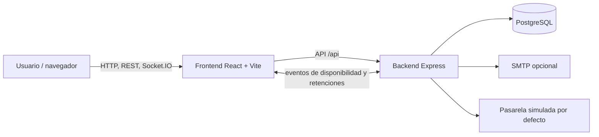

# Documentación técnica final — CanchaYa

**Alcance:** operación local, validación CI/CD y preparación del despliegue del incremento Sprint 5.  
**Stack:** Node.js 22, React 18/Vite, Express 4, PostgreSQL 16, Socket.IO, Docker Compose y GitHub Actions.

## 1. Arquitectura



El frontend sirve la aplicación web y consume el backend bajo `/api`. El backend organiza rutas, controladores, servicios y repositorios; PostgreSQL conserva cuentas, canchas, reservas y pagos. Socket.IO distribuye cambios de disponibilidad y retenciones temporales. Swagger UI está disponible en `/api/docs` cuando la configuración la habilita.

## 2. Requisitos y ejecución local con Docker

Se necesita Git, Docker Desktop con Docker Compose y Node.js 22 para ejecutar herramientas y pruebas fuera de los contenedores.

1. Copia `.env.example` a `.env` en la raíz.
2. Sustituye `JWT_SECRET` por un valor aleatorio y define `POSTGRES_PASSWORD`.
3. Inicia el entorno con `docker compose up -d --build --wait --wait-timeout 180`.
4. Abre el frontend en `http://localhost:8080`, la API en `http://localhost:4100/api` y la documentación OpenAPI en `http://localhost:4100/api/docs`.
5. Revisa el estado con `docker compose ps` y los registros con `docker compose logs -f backend`.
6. Para detener el entorno sin borrar la base, ejecuta `docker compose down`. `docker compose down -v` elimina el volumen y los datos locales.

El backend aplica el esquema SQL idempotente al arrancar. El servicio de base de datos usa un volumen Docker llamado `db-data`.

### Desarrollo con servicios separados

Para ejecutar el frontend y backend fuera de Docker, configura `backend/.env` con `DATABASE_URL`, `JWT_SECRET` y `CORS_ORIGIN`; instala dependencias con `npm ci` y ejecuta `npm run dev` en `backend/`. Configura `frontend/.env` con `VITE_API_URL`, luego instala dependencias y ejecuta `npm run dev` en `frontend/`. El backend necesita un PostgreSQL accesible antes de arrancar. Las pruebas backend que requieren base también necesitan que `DATABASE_URL` apunte a una instancia de prueba con el esquema aplicado.

> `npm run seed:canchas` reemplaza el catálogo y puede borrar en cascada sus reservas. No lo ejecutes en una base con información que quieras conservar. `npm run seed:mas-canchas` añade canchas de ejemplo sin borrar las existentes.

## 3. Configuración

No subas archivos `.env` ni secretos al repositorio. Los nombres y valores por defecto se mantienen en las plantillas `.env.example` y `backend/.env.example`.

| Variable | Dónde | Uso |
|---|---|---|
| `JWT_SECRET` | raíz y backend | Secreto requerido para firmar tokens. Debe ser fuerte y privado. |
| `POSTGRES_PASSWORD` | raíz | Contraseña del PostgreSQL de Docker Compose. |
| `DATABASE_URL` | backend | Cadena de conexión PostgreSQL al ejecutar backend sin Compose. |
| `BACKEND_PORT`, `FRONTEND_PORT` | raíz | Puertos locales publicados; por defecto 4100 y 8080. |
| `VITE_API_URL` | frontend | URL pública de la API para el bundle del frontend. Compose usa `http://localhost:4100/api` localmente. |
| `CORS_ORIGIN` | backend/Compose | Origen permitido por la API. Para producción debe ser el dominio real del frontend. |
| `SMTP_HOST`, `SMTP_PORT`, `SMTP_USER`, `SMTP_PASS`, `SMTP_FROM` | backend/raíz | Envío de recuperación de contraseña, cambio de correo y notificaciones. Sin SMTP en desarrollo, algunos enlaces se escriben en los logs. |
| `PASARELA_PAGO` | backend | `simulada` por defecto. El proyecto no configura una pasarela real. |
| `EXIGIR_HTTPS_PAGOS`, `TRUST_PROXY` | backend | En producción, activar HTTPS y confiar en el proxy solo si la app está detrás de un proxy TLS controlado. |
| `HORAS_MIN_CANCELACION` | backend | Anticipación mínima para cancelaciones propias; por defecto 2 horas. |
| `MAX_RESERVAS_ACTIVAS_USUARIO` | backend | Máximo de reservas simultáneas; por defecto 5. |
| `API_DOCS_HABILITADA` | Compose/backend | Controla Swagger UI según el entorno. |

Los valores de ejemplo son para desarrollo local. Antes de un entorno público, define dominios HTTPS, CORS, correo y secretos en la plataforma de despliegue; no reutilices credenciales de ejemplo.

## 4. API y base de datos

- La especificación OpenAPI está en [backend/openapi/openapi.yaml](../backend/openapi/openapi.yaml) y su vista interactiva en `/api/docs`.
- Los eventos Socket.IO se describen en [docs/api/eventos-socket.md](api/eventos-socket.md).
- La cobertura de endpoints documentados se genera con `cd backend && npm run docs:cobertura`; el criterio del pipeline es mínimo 90 %.
- El esquema principal está en `backend/src/db/schema.sql`; en Docker se aplica al arranque. `cd backend && npm run migrate` lo aplica a la base indicada por `DATABASE_URL`.
- Las cuentas de administrador se habilitan por operación controlada con `npm run admin:promover -- correo@ejemplo.com` o `npm run crear:admin -- correo@ejemplo.com`. No existe alta pública de administradores.

## 5. Pipeline CI/CD

La definición está en [.github/workflows/ci-cd.yml](../.github/workflows/ci-cd.yml). Los cambios de esta rama quedan cubiertos al abrir un Pull Request hacia `main`, `develop` o una rama `sprint_*`; también hay ejecución al hacer push en esas ramas y las ramas de trabajo configuradas, incluida `Pipeline-CI/**`.

| Job | Validación / salida |
|---|---|
| Backend — lint y pruebas | Node 22, dependencias reproducibles, Spectral, cobertura de OpenAPI, migración y Jest contra un PostgreSQL desechable; publica reportes. |
| Frontend — lint y build | ESLint, build de producción de Vite y pruebas con cobertura; publica LCOV. |
| SonarQube Quality Gate | Se ejecuta cuando backend y frontend pasan. `SONAR_HOST_URL` y `SONAR_TOKEN` habilitan el análisis; si faltan o el servidor no responde, registra aviso y continúa. Si el servidor responde, un Quality Gate fallido detiene los jobs dependientes. |
| Docker — build y smoke test | Construye y levanta PostgreSQL, API y frontend; ejecuta `scripts/smoke-test.sh`, luego la prueba de 100 conexiones Socket.IO y baja el entorno temporal. |
| Despliegue en la nube y pruebas de humo | Solo en push a `sprint_5` y con la variable `DESPLIEGUE_NUBE=true`; ver el [manual de despliegue y operación](despliegue-y-operacion.md). |

El pipeline ya no usa un runner self-hosted (el despliegue local fue retirado); todos los jobs corren en los runners de GitHub. El análisis de SonarQube usa la variable de repositorio `SONAR_HOST_URL` y el secreto `SONAR_TOKEN`. Ningún valor sensible debe escribirse en los archivos versionados.

## 6. Evidencia y cómo repetir la validación

Las capturas de ejecuciones ya completadas están en [Evidencias CI/CD](evidencias-pipeline-cicd.md). Incluyen checks aprobados, un job Docker con smoke test y un despliegue previo. Para obtener evidencia nueva de este cambio, publica la rama y abre un Pull Request a `sprint_5`; adjunta el enlace al run y conserva los artefactos backend/frontend. El trabajo de esta entrega no incluye push, por lo que no se atribuye un run nuevo a estos cambios.

Validaciones locales disponibles:

```powershell
cd backend
npm ci
npm run docs:lint
npm run docs:cobertura
npm test -- --runInBand

cd ..\frontend
npm ci
npm run lint
npm run build
npm test
```

El job Docker de GitHub Actions se valida en un runner con Docker Compose; los comandos locales no sustituyen una ejecución real de GitHub Actions. Consulte [qa/README.md](../qa/README.md) para la suite de QA sobre un proyecto Docker aislado.

## 7. Preparación del despliegue

> El despliegue en la nube (Vercel + Railway), los respaldos, el monitoreo, el rollback y las pruebas de humo y de carga están en el [manual de despliegue y operación](despliegue-y-operacion.md) (US-22 a US-26). Lo siguiente resume los puntos previos.

Antes de habilitar un entorno público:

1. Definir dominio HTTPS del frontend y URL pública de API; revisar `CORS_ORIGIN` y `VITE_API_URL`.
2. Cargar los secretos y variables de GitHub que indica el manual de despliegue (sección 6).
3. Configurar SMTP y la pasarela real, si se van a enviar correos o cobrar pagos reales. La pasarela actual es simulada.
4. Activar HTTPS para tarjetas y configurar el proxy seguro correspondiente.
5. Confirmar que los checks requeridos están verdes y tener un plan de respaldo de PostgreSQL antes de actualizar datos.
6. Ejecutar `npm run migrate` en la base real antes de desplegar (los cambios del Sprint 5 agregan tablas y columnas) y crear al menos un administrador.

El workflow despliega automáticamente al recibir un push exitoso en `sprint_5`; no es necesario ejecutar una acción de despliegue para documentar o revisar esta rama.

## 8. Gestión de canchas (US-15)

Un administrador puede crear, editar, desactivar y reactivar canchas desde `/admin/canchas`. Todo está integrado en el backend activo (CommonJS, `pg`, `adminMiddleware` que lee el rol de la base en cada petición).

| Método y ruta | Qué hace |
|---|---|
| `GET /api/admin/canchas` | Todas las canchas, también las desactivadas, con el número de reservas futuras confirmadas. |
| `GET /api/admin/canchas/{id}` | Una cancha con su horario de atención. |
| `POST /api/admin/canchas` | Crea una cancha activa con su horario; aparece en el catálogo público. |
| `PUT /api/admin/canchas/{id}` | Reemplaza los datos y el horario. Las reservas ya confirmadas no se alteran. |
| `PATCH /api/admin/canchas/{id}/desactivar` | Desactivación lógica. Con reservas futuras responde `409 CONFIRMACION_REQUERIDA` (con las reservas afectadas) hasta recibir `{ "confirmar": true }`. |
| `PATCH /api/admin/canchas/{id}/activar` | Vuelve a mostrar la cancha y a admitir reservas. |

**Reglas:**
- Validaciones (400 con detalle por campo): nombre y dirección obligatorios, precio por hora mayor que 0, al menos un horario, hora de cierre posterior a la de apertura, un horario por día y tipo dentro de la lista.
- Una cancha desactivada no aparece en `GET /api/canchas`, su detalle responde 404 y crear una reserva responde `409 CANCHA_NO_DISPONIBLE`. La columna usada es `canchas.disponible`; nada se borra.
- Sin rol de administrador: 403 en todas las rutas (401 sin sesión). La interfaz oculta el acceso y `AdminRoute` devuelve al catálogo.

El módulo separado que se había agregado antes (`canchas.routes.js`, `canchas.controller.js` y `authAdmin.js`, con ES Modules, Sequelize y un rol `ADMIN` que el proyecto no usa, y sin montar en el router) se reemplazó por esta implementación y se eliminó.
