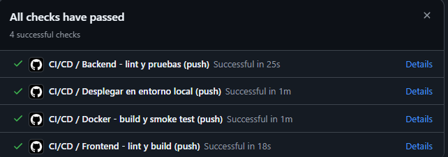
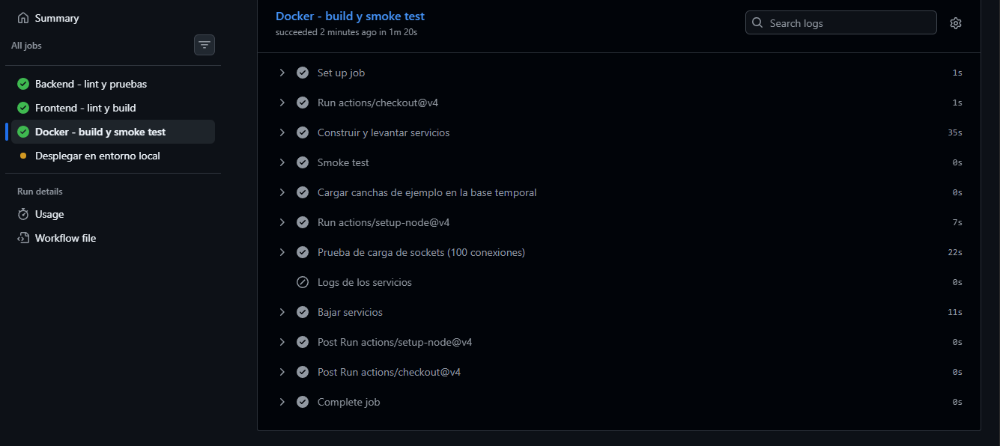
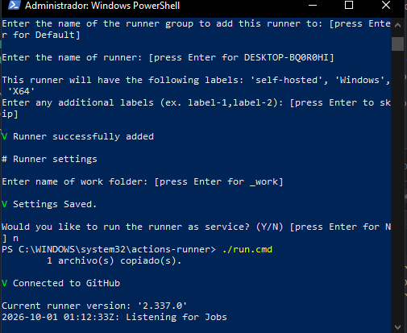
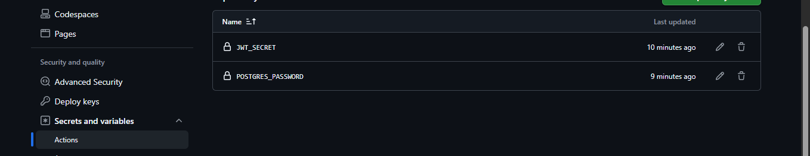

# Evidencias del pipeline CI/CD — CanchaYa

El workflow versionado en [`.github/workflows/ci-cd.yml`](../.github/workflows/ci-cd.yml) automatiza backend, frontend, calidad, smoke test con Docker y despliegue local de Sprint 5.

## Ejecuciones capturadas

Las imágenes siguientes son evidencia visual de ejecuciones previas del pipeline que ya estaban en el repositorio. Muestran los resultados indicados en la interfaz de GitHub Actions; no representan una ejecución nueva de esta rama.

### Checks aprobados en GitHub

La captura muestra cuatro checks exitosos: backend, despliegue local, Docker y frontend.

### Docker build y smoke test

La ejecución del job Docker muestra completados el build/arranque, smoke test, carga de canchas para la prueba aislada y prueba de 100 conexiones Socket.IO; al final baja los servicios temporales.

### Configuración de runner y secretos

Evidencia histórica: el despliegue local con runner propio se retiró en la entrega final y hoy todos los jobs corren en los runners de GitHub. Las siguientes capturas documentan el runner self-hosted conectado y la configuración de secretos del repositorio. Los valores secretos no se exponen.

## Qué acredita el workflow

- Backend: análisis OpenAPI, porcentaje de endpoints documentados, migración SQL y pruebas Jest con PostgreSQL temporal.
- Frontend: ESLint, build Vite y pruebas Vitest con cobertura.
- Docker: build y arranque de los tres servicios, smoke test HTTP y carga Socket.IO.
- SonarQube: Quality Gate si hay servidor disponible y secretos configurados.
- Despliegue: (histórico) ejecución en el runner self-hosted después de pasar los jobs; retirado. El despliegue actual es en la nube (ver el manual de despliegue y operación).

## Renovar la evidencia para la entrega

Después de publicar esta rama, abre un Pull Request contra `sprint_5` y conserva el enlace del run de Actions. Verifica que los checks requeridos terminen en verde y descarga `backend-reports` y `frontend-reports` si se necesitan los reportes de cobertura. Un push aprobado a `sprint_5` puede ejecutar el despliegue local configurado; confirma la disponibilidad del runner y los secretos requeridos antes de integrar.
